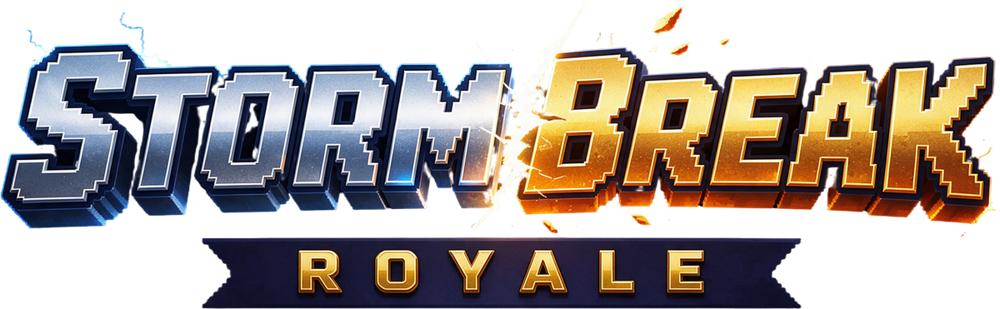

<p align="center"></p>

# Stormbreak Royale

Een real-time Pokémon battle royale voor de browser, mobile first, in de stijl van Black/White.

**Speel:** https://stormbreak.app

Er zijn drie modi:
- **Battle Royale:** 12 trainers, wie als laatste overblijft wint.
- **1 vs 1:** een duel in een stadion, best of 3: online, tegen de CPU of met een vriend.
- **Raid:** alleen of samen tegen één enorme eindbaas.

Op het home-scherm kies je eerst de modus en dan hoe je speelt: online, solo/CPU of met vrienden.

Na een korte uitleg vul je je naam in en kies je: **solo** tegen bots, of **samen** met vrienden. Je kiest een trainer en één partner-Pokémon uit een roster van 24 (te filteren op rol en op melee/ranged); in de wereld vang je er nog twee bij (max. 3). Daarna word je gedropt op een grote kaart met in totaal 12 trainers. Je Pokémon loopt achter je aan en vecht in real time. Versla en vang wilde Pokémon, raap Master Balls en items op en blijf binnen de zone. Wie als laatste trainer overblijft, wint.

## Spelen

```sh
npm install
npm run dev       # http://localhost:5173 (ook bereikbaar via je LAN voor je telefoon)
npm run build     # type-check + productie-build naar dist/
```

Vercel herkent het project automatisch als Vite-app (build: `npm run build`, output: `dist`).

### Besturing

| Actie | Mobiel | Toetsenbord |
| --- | --- | --- |
| Lopen | Joystick: tik ergens op de linkerhelft | WASD / pijltjes, of houd de rechtermuisknop vast (lopen naar de cursor) |
| Aanval 1 | Tik = automatisch richten, vasthouden = blijven aanvallen, slepen = zelf richten, loslaten = vuren | Linkermuisknop (vasthouden = blijven schieten) |
| Aanval 2 / 3 / ultimate | Idem op de andere knoppen | Q / E / R, gericht op je cursor |
| Pokémon wisselen | Tik op een Pokémon in je team (linksboven) | F |
| Vangen (verzwakte wilde Pokémon) | VANG!-knop | Spatie |
| Master Ball / Potion / Revive | Itemknoppen | 1 / 2 / 3 |
| Pauze / game verlaten | ❚❚-knop of de terugknop van je telefoon (vraagt eerst om bevestiging) | Esc |

- **Eigen toetsen:** Opties → Besturing. Tik op een actie en druk op de nieuwe toets; een toets die al in gebruik is, wisselt van plek. Esc pauzeert altijd en de pijltjes lopen altijd ook. Aanval 1 kan naast de linkermuisknop ook een toets krijgen. Bewaard in de browser (`keys.ts`).
- **Controller** (ook handhelds zoals de AYN Thor): linkerstick lopen, rechterstick richten, A / X / Y aanval 1-3, RT of RB ultimate, B vangen, LB wissel, D-pad items, Start pauze, Select scorebord, LT chat. In menu's: D-pad of stick navigeert, A kiest, B terug, LB/RB tabbladen (`pad.ts`).
- **Tweede scherm** (`/duo/`, bijvoorbeeld het onderscherm van de AYN Thor): kaart, baas of score, je team (tik = wissel), items, scorebord, pauze en de chat. Verbindt vanzelf met het spel in dezelfde browser; installeerbaar als eigen app ("Stormbreak Duo") op `duo.stormbreak.app` (eigen origin, dus los van de hoofdapp; een verborgen frame `duo-bridge.html` op www geeft de berichten door, want een BroadcastChannel werkt alleen binnen één origin). Opties → Tweede scherm probeert het via de browser op het andere scherm te zetten (`duo.ts`, `ui/duoView.ts`).
- **Geluid via mediaspeler** (Opties): stuurt al het geluid via een `<audio>`-element met media session in plaats van direct naar de speakers. Auto = aan zolang een tweede scherm verbonden is (op de AYN Thor viel het geluid weg met /duo in een tweede Chrome-venster).
- **Moeilijkheid** (Makkelijk / Normaal / Moeilijk) bij solo, tegen de CPU en in je eigen lobby: hoe scherp de bots, de CPU of de baas spelen en hoeveel schade je van ze krijgt (×0,7 / ×1 / ×1,3). PvE-rankingpunten tellen half (makkelijk) of 1,5× (moeilijk). Openbare lobby's spelen altijd normaal (`data/difficulty.ts`).

## Samen spelen

Zit je naast iemand? Dan heb je zo een potje:

1. Speler 1 vult in het hoofdmenu een naam in, kiest een modus, tikt **Met vrienden** en dan **Potje maken**. Er verschijnt een code van 4 tekens en een QR-code.
2. Speler 2 tikt bij een modus op **Met vrienden** en typt de code bij **Meedoen**, of scant de QR-code met de camera. De link opent de game en doet meteen mee.
3. In de lobby kiest iedereen een trainer en Pokémon met **Team kiezen** en tikt op **Klaar**. Je ziet bij iedereen of die klaar is, en je kunt chatten (ook met snelle knoppen).
4. De host kiest bovenin de lobby de modus (Battle Royale, 1 vs 1 of Raid) en de wereld. De anderen zien die keuze meteen. 1 vs 1 kan alleen met precies 2 spelers.
5. Zodra iedereen klaar is, tikt de host **Start!** Iedereen ziet 8 seconden een laadscherm met tips en start dan tegelijk. De lege plekken (tot 12) worden bots.

In het potje zelf kun je ook chatten via de 💬-knop (op desktop: Enter).

Na afloop ga je terug naar de lobby voor een rematch, of kijk je mee tot het potje klaar is. Valt iemand weg, dan neemt een bot die trainer over.

**Hoe het technisch werkt:** de telefoons praten rechtstreeks met elkaar via WebRTC; PeerJS helpt ze alleen elkaar te vinden. Er is dus geen eigen gameserver nodig.
- **De host** rekent het hele potje uit: bots, wilde Pokémon, schade, de storm en in een raid de baas en zijn aanvallen. Hij stuurt 20× per seconde de stand naar de anderen, met de effecten, geluiden en banners die zij moeten zien.
- **Je eigen trainer** beweegt lokaal, zodat lopen direct aanvoelt.
- **Elke speler krijgt alleen details van wat in de buurt is,** plus het minimum van de rest (positie, of iemand nog leeft, legendarische Pokémon voor de minimap). Dat is ~30 KB/s per medespeler. Getest met 8 spelers tegelijk; een potje kan er 12 hebben.
- **De host moet de game open houden.** Gaat het scherm van de host op slot, dan staat het potje stil.

Je naam en een willekeurige speler-id worden op je toestel bewaard (`src/profile.ts`). Een account/inlog kan dat later vervangen.

Lokaal testen zonder internet: start een eigen PeerJS-server (`npx peer --port 9000`) en open de game met `?peer=127.0.0.1:9000`.

## Hoe het werkt

- **Levelen:** je hele team krijgt passief XP zolang je leeft. Schade doen en KO's leveren veel meer op. Een match duurt maar een paar minuten, dus het gaat snel: de eerste evolutie komt rond 1:30–2:00. Op Lv 8, 16 en 25 komt er een nieuwe aanval vrij (de vierde is een ultimate). Starters evolueren op hun echte levels.
- **Aanvallen:** elke Pokémon krijgt 4 echte aanvallen op basis van zijn types, elk met een eigen gedrag en effect. Thunder Shock is een bliksemflits die direct raakt, Thunderbolt springt door naar extra doelen, Thunder slaat in vanuit de lucht, Flamethrower is een vlammenstraal, Fire Blast een 大-explosie, Draco Meteor laat drie meteoren neerkomen, Aura Sphere en Swift zoeken hun doel zelf op, en Solar Beam, Hyper Beam, Hydro Pump, Flash Cannon en Focus Blast moeten eerst opladen (een draaiende cirkel op de grond, toestromende energie, een groeiende witgloeiende bol en een trillende Pokémon), maar slaan dan 15% harder toe. Daarbovenop geldt het complete Gen V-typeschema.
- **Licht en impact:** projectielen, opladers, inslagen, bliksem, stralen en raid-aanvallen werpen dynamisch licht op de grond (ook in het donker van de nacht). Treffers worden zwaarder naarmate de aanval sterker is: meer vonken, lichtflares, schokgolven en schermschok, en het doelwit veert in bij een klap.
- **Duidelijk vechten:** boven elke Pokémon staat een naamplaat met een HP-balk in teamkleur (groen jij, rood rivalen, geel wild) en een nazakkende schadestrook. Je huidige doelwit krijgt rode haken. Treffers geven grote schadegetallen, "Super effectief!" en een tik-geluid; missers tonen "Mis". Melee-aanvallen laten je Pokémon naar het doel schieten.
- **Verstoppen in het hoge gras:** trainers en hun Pokémon in het hoge gras zijn onzichtbaar en niet aan te vallen voor iedereen die verder dan ~3 tegels weg staat. Aanvallen of geraakt worden verraadt je even. Een oogje boven je trainer laat zien of je verborgen bent (dicht, groen) of net gezien bent (open, rood). Wilde Pokémon blijven zichtbaar.
- **Herstellen:** ben je 3 seconden niet in gevecht geweest (geen schade gedaan of gekregen, niet in de storm), dan herstelt je actieve Pokémon 12% HP per seconde en je reserve-Pokémon 6%. Bewusteloze Pokémon hebben nog steeds een Revive nodig.
- **Wilde Pokémon:** die leven in het hoge gras en zijn er in gewoon, ongewoon en zeldzaam, met een kleine kans op shiny. Er zijn er niet veel (~24 bij de start, minder naarmate de zone krimpt), maar hoe langer de match duurt, hoe vaker er zeldzame tussen zitten. Versla er een en hij is een paar seconden verzwakt: tik dan op VANG!. Twee keer per match verschijnt er op een willekeurig moment een legendarische Pokémon (ergens tussen 1:00–1:40 en 3:10–4:10), zichtbaar op de minimap.
- **Master Ball:** daarmee vang je elke wilde Pokémon direct, dus ook een legendarische, zonder te vechten.
- **Evolutiekristal:** één per potje, vroeg (rond 30–45 s) ergens in de zone. Iedereen krijgt een melding, maar niet waar: hij staat niet op de kaart en er is geen pijl. Alleen een lichtzuil verraadt de plek als je in de buurt bent. Loop eroverheen en je actieve Pokémon evolueert meteen volledig, met het level dat daarbij hoort (minstens Lv 25) en alle vier de aanvallen. Alleen echte spelers kunnen hem pakken, bots niet. Je kans om vroeg de jacht te openen.
- **Legendarisch alarm:** als er een legendarische Pokémon verschijnt, flitst het scherm goud. Een gouden balk bovenin toont de naam, de afstand, een pijl in de juiste richting en hoe je hem vangt.
- **Eerlijk vangen:** wie een wilde Pokémon verslaat, mag hem eerst vangen: 3 seconden, bij een legendarische 8. Daarna mag iedereen een poging doen.
- **Zone:** de storm krimpt in 6 fases. Daarbuiten verliest je actieve Pokémon HP: 4,5% per seconde in de eerste fase, oplopend tot 25% in de laatste. Hoe langer je erin blijft, hoe harder het gaat (+10% per seconde, tot 2,5×).
- **Bots:** AI-trainers met verschillende skill. Ze farmen wilde Pokémon, vangen, rapen items op, vluchten de zone in en vallen aan of vluchten afhankelijk van hun HP en level.
  - Ze hebben een reactietijd, richten niet altijd perfect en kiezen niet altijd hun beste aanval.
  - Ze krijgen iets minder XP.
  - Ze bemoeien zich niet met een gevecht dat al bezig is, tenzij ze zelf geraakt worden.
  - Ze laten andere trainers de eerste minuut met rust.
  - Een legendarische Pokémon pakken ze alleen aan als ze duidelijk sterk genoeg zijn. Ze gebruiken er nooit een Master Ball voor, en hij breekt vaak uit hun bal.

## Rollen

Net als in Pokémon Unite heeft elke partner een rol en een aanvalsstijl. Je ziet ze bij de stats op het keuzescherm en kunt erop filteren. De rol geeft een klein voordeel; evoluties houden de rol van hun lijn, en wilde Pokémon krijgen een rol op basis van hun stats.

| Rol | Bonus | Partners |
| --- | --- | --- |
| **Aanvaller** | +10% schade | Pikachu, Charmander, Bulbasaur, Gastly, Abra, Shinx, Deino |
| **Allrounder** | +5% schade, +7% HP | Eevee, Tepig, Oshawott, Gible, Axew, Machop, Dratini, Beldum |
| **Verdediger** | +15% HP, halve knockback | Squirtle, Larvitar, Munchlax, Mudkip |
| **Snelheid** | +12% loopsnelheid, 20% kortere cooldown op dash-aanvallen | Snivy, Riolu, Zorua, Scyther, Torchic |

**Melee** of **Ranged** volgt uit de basisaanval (de aanval die je het vaakst gebruikt).

## Werelden en gebeurtenissen

Elke battle royale speelt in een van vijf werelden. In solo kies je die zelf, in multiplayer de host; standaard is het **Willekeurig**.

| Wereld | Wat is anders |
| --- | --- |
| **Bos** | Het klassieke groen met eiken, vijvers en dorpjes |
| **Woestijn** | Duinen, cactussen en droge struiken als verstopplek, een oase en zandstormen |
| **Sneeuw** | Besneeuwde dennen, bevroren meertjes en sneeuwval |
| **Vulkaan** | Asgrond, dode bomen, gloeiende lava in plaats van water en asregen |
| **Nacht** | Het bos in het donker, met vuurvliegjes en een donkere rand om het beeld |

Elk potje heeft twee gebeurtenissen, tussen de legendarische Pokémon door. Beide krijgen een banner, een pijl bovenin en een marker op de minimap.
- **Bevoorrading:** na 10 seconden aftellen valt er een kist met een Master Ball, Potions, Rare Candy en een Revive.
- **Zwerm:** zes wilde Pokémon van dezelfde ongewone of zeldzame soort in een stuk hoog gras.

## 1 vs 1

Een duel tussen twee trainers in een stadion, best of 3.
- **Stadions:** een rechthoekig wedstrijdveld met witte lijnen, een middencirkel, trainervakken en een Poké Ball in het midden. Eromheen staan een muur met reclameborden en tribunes vol publiek. Jouw kant heeft de ene clubkleur, de tegenstander de andere. Het publiek doet een wave, springt af en toe op en juicht als een ronde beslist is. Elke indeling is gespiegeld, zodat beide spelers hetzelfde veld hebben.
  - **Pokémon Stadion:** gras met maaistroken, hagen langs de zijlijn om je te verstoppen, beelden als dekking.
  - **Woestijnarena:** zand, rotsblokken en droog gras.
  - **IJsbaan:** een gladde ijsbaan in het midden (je glijdt door) met sneeuw en grip langs de rand, plus vallende sneeuw.
  - **Waterarena:** twee bassins met elk een brug. Lopen kan alleen via de bruggen, schieten kan eroverheen.
  - **Vulkaanarena:** donkere steen met lavapoelen die je de weg versperren, maar je aanvallen niet.

  Solo en in een lobby kies je een stadion of Willekeurig. Testen kan met `?stadium=<id>`.
- **Kracht:** beide partners zijn volledig geëvolueerd op Lv 50 met alle vier de aanvallen, net als in een raid. Het gaat om skill en de match-up van types en rollen. HP herstelt niet vanzelf.
- **Rondes:** wie de Pokémon van de ander verslaat, wint de ronde. Daarna begint de volgende met volle HP vanaf de startplekken, na een aftelling van 3 seconden. Wie eerst twee rondes wint, wint het duel.
- **Tijdslimiet in plaats van een storm:** een ronde duurt maximaal 75 seconden. Is de tijd op, dan wint wie relatief de meeste HP over heeft. Bij gelijke stand wordt de ronde opnieuw gespeeld. De klok staat in de duel-balk en wordt rood in de laatste 10 seconden.
- **Power-ups:** ze liggen op drie plekken, de eerste na 6 seconden en na het oppakken 14 seconden later weer:
  - **X Attack:** +35% schade, 10 s;
  - **X Speed:** sneller lopen en kortere cooldowns, 10 s;
  - **X Defense:** −40% schade, 10 s;
  - **Hyper Potion:** +40% HP.

  Het middelste plekje geeft vaker X Attack of een Hyper Potion.
- **Spelen:**
  - **Online:** eigen openbare lobby's, apart van die van Snel spel. Je komt bij de eerste die op een tegenstander wacht; vind je niemand binnen 30 s, dan speel je tegen de CPU.
  - **Tegen de CPU:** de CPU zoekt je op waar hij je het laatst zag, pakt power-ups, en loopt via het midden om obstakels heen als hij vastzit.
  - **Met een vriend:** een eigen duel met een code. Een duel-lobby laat maximaal 2 spelers toe.
- **Progressie:**
  - **Tegen een mens:** XP per gewonnen ronde plus winst-XP en PvP-punten.
  - **Tegen de CPU:** minder XP, en de punten tellen voor PvE.
  - **Prestaties:** drie nieuwe, met de titel "Gladiator" bij 10 gewonnen duels.
- **Code:**
  - `src/game/duel.ts`: rondes, tijdslimiet en power-ups;
  - `src/data/stadiums.ts`: de stadions;
  - `src/game/world.ts`: indeling en tekenwerk (`generateStadium`, `paintStand`, `paintField`);
  - `src/game/render.ts`: het bewegende publiek (`drawCrowd`);
  - `src/game/ai.ts`: de CPU.

## Raid

Een raid is PvE: jij (en tot 11 vrienden) tegen één legendarische baas, in een eigen arena. Er is geen storm en er zijn geen bots of wilde Pokémon. De baas is een verrassing: hij wordt willekeurig gekozen (nooit twee keer dezelfde na elkaar) en je ziet hem pas op het laadscherm.

- **Jouw team:** je partner is in de raid volledig geëvolueerd en Lv 50 met alle vier de aanvallen (Pikachu wordt Raichu, Charmander Charizard, enzovoort). Je hebt 2 Potions en HP herstelt niet vanzelf. Er verschijnen wel geregeld Potions in de arena.
- **Ontwijken:** elke grote aanval zie je eerst als rode vorm op de grond die langzaam volloopt: een cirkel, kegel, lijn of ring. Sta je erin als hij vol is, dan kost dat een groot deel van je HP. Elke waarschuwing is lang genoeg om eruit te lopen als je meteen reageert.
- **Fases:** op 66% en 33% HP wordt de baas woedend. Dat is een korte cinematic: de camera zwenkt naar de baas, de wereld wordt donker, hij brult (een eigen animatie), en op een flits met schokgolf verschijnt zijn nieuwe vorm. Hij brult iedereen weg, krijgt nieuwe aanvallen en valt sneller aan, en er vallen Potions.
- **Elke fase voelt anders:** een eigen kleur over het scherm, een pulserende rand (in de laatste fase op het ritme van een hartslag), meer weer en een arena die escaleert: hitte uit de vloer, sneeuwstormvlagen, onweer dat de lucht verlicht, windstrepen of een vervormende werkelijkheid. De baas gloeit in de kleur van zijn fase.
- **Laatste fase, nieuwe vorm:** Kyurem wordt **Black Kyurem** (ijs + bliksem: Freeze Shock, Fusion Bolt), Rayquaza wordt **Mega Rayquaza** (Extreme Speed), Mewtwo wordt **Mega Mewtwo Y** (Aura Sphere). Reshiram gaat over op blauw vuur (Dragon Rush, Blauwe Vlammenstorm) en Zekrom op Teravolt (Teravolt-sprong: springt op en landt op je).
- **Animatie:** de bazen spelen hun echte geanimeerde Black/White-sprites af, zweven (Rayquaza, Mewtwo) of stampen, en laten nabeelden achter bij een dash.
- **Levens en tijd:** iedereen heeft één revive: ga je neer, dan kom je na 10 seconden één keer terug aan de rand. De tweede keer kijk je mee. De raid mislukt als iedereen op is of na 4 minuten. Met meer spelers heeft de baas meer HP.
- **Afloop:** "Raid geslaagd!" of "Raid mislukt" met je tijd, je aandeel in de schade en je levens.

| Baas | Arena | Wat de omgeving doet | Signature-aanvallen |
| --- | --- | --- | --- |
| **Reshiram** | Vulkaankrater | Lavascheuren branden als je erop staat; uit vier kraters spuit lava (Uitbarsting) | Blue Flare (kegel), Fusion Flare (meteoren), Hittegolf, Vuurring, en in fase 3 Cross Flame: draaiende vlammenstralen |
| **Kyurem** | IJsgrot | De vloer is glad, waardoor je doorglijdt; ijspilaren geven dekking en breken na drie treffers | IJsadem (bevriest je), Icicle Crash, Dragon Pulse, Glaciate, Vriesgolf, en in fase 3 Blizzard: de hele arena, behalve achter een pilaar |
| **Zekrom** | Stormtop | Vier bliksemafleiders blokkeren je pad en schieten om de paar seconden stroom naar elkaar: sta niet tussen twee masten | Bolt Strike (inslagen uit een donderwolk), Fusion Bolt (Zekrom raast over de lijn), Discharge, Donderring, en in fase 3 Onweer: inslagen over de hele arena en alle afleiders tegelijk |
| **Rayquaza** | Hemelpilaar | Het oude stenen dak van de toren, met mos, gebroken pilaren en open lucht als rand; wervelwinden trekken door de arena en doen schade zolang je erin staat | Dragon Ascent (vliegt op en landt op een speler), Outrage (drie lijnen), Draco Meteor, Hurricane (tornado's), en in fase 3 Delta Stream: harde wind die iedereen één kant op duwt |
| **Mewtwo** | Psychisch lab | Het vloerraster laadt op: de helft van de vakken (dambordpatroon) slaat toe, dus ga op tijd naar een donker vak | Psystrike (kegel), Shadow Ball, Teleport (verschijnt naast je en slaat om zich heen), Psychische ring, en in fase 3 twee klonen die de aanvallen meedoen |

Nieuwe bazen zijn vooral data: een rij in `src/data/bosses.ts` met hun aanvallen, vormen en uiterlijk per fase, plus eventueel een arena in `src/game/world.ts`.

**Sprites en animaties van de bazen**
- `scripts/bake-boss-sprites.py` zet de geanimeerde BW-sprites (GIF) om in sprite sheets (`src/assets/boss/<id>.png`) met frametijden (`src/data/bossAnims.ts`). Nieuwe vorm erbij: zet het id in de lijst en draai het script opnieuw.
- `scripts/bake-ai-anim.py` maakt van een AI-animatie een pixel-art actie (zoals de brul bij een fasewissel). Werkwijze: zet de sprite 6× vergroot op een effen greenscreen (#00b140; magenta #ff00ff voor groene Pokémon zoals Rayquaza), animeer die met MiniMax H3 (startframe = eindframe, vaste camera), en draai het script. Dat haalt de achtergrond weg, schaalt terug naar spritegrootte en zet elke pixel op het palet van de echte sprite. Resultaat: `src/assets/boss/<id>-<actie>.png` en `src/data/bossActions.ts`.

## Presentatie

- **Soundtrack:** "Castelia Nights", eigen muziek in Black/White-stijl die live in de browser wordt gespeeld door een kleine DS-achtige synth (`src/synth.ts`): pulse-lead, marimba, synthbas, strijkers, drums en galm. Er zijn nummers voor het titelscherm, het menu, de battle royale (versnelt in de finale), de raid-baas (versnelt in de laatste fase), overwinning en nederlaag. Twee alternatieve sets staan in `src/data/soundtracks.ts`. Plus Pokémon-cries via PokéAPI.
- **Geluidseffecten:** elke aanval heeft een eigen gesynthetiseerd geluid (`src/moveSfx.ts`): de klank van het type, de vorm van de aanval en zwaarder naarmate de aanval sterker is. Geluiden van anderen komen uit de goede richting en worden zachter op afstand. Items (potion, revive, ballen, oppakken) hebben ook hun eigen geluid. Raid-bazen hebben een eigen, zwaardere set: elke aanval zwelt aan tijdens de waarschuwing en slaat in met een diepe dreun over de hele arena, plus geluid voor de dash, het opstijgen en neerkomen, de teleport, de klonen, tornado's en Delta Stream, de bliksemafleiders, lavagaten, het vloerraster en brekende ijspilaren. De baas brult bij de start, de nieuwe fase klinkt als een ontlading en zijn nederlaag als een instorting.
- **Omroeper:** een stem met een Japans accent (ElevenLabs, `src/assets/voice/`, afgespeeld door `src/voice.ts`) roept het titelscherm, het aftellen, de storm, legendarische Pokémon, K.O.'s, raid-fases en winst of verlies om. De muziek gaat even zachter terwijl hij praat.
- **Opties:** via ⚙️ in het menu zet je muziek, stemmen en geluidseffecten los aan of uit; de keuze wordt onthouden.
- **Talen:** Engels (standaard) en Nederlands, te kiezen op het titelscherm, het home-scherm en in Opties (`src/i18n.ts`).
- **Cinematisch:** een titelscherm met Zekrom en Reshiram, Black/White-schermovergangen, keuzeschermen als podium, een drop-in met aftelling bij de start, een evolutie-cutscene, banners voor level-ups, nieuwe aanvallen, legendarische Pokémon en KO's, en een resultaatscherm met confetti.
- **Wereld:** weer per wereld (sneeuw, zand, as, gloeiende vonken, vuurvliegjes), wolkschaduwen, golvend en glinsterend water, ritselend gras, stofwolkjes, zwevende pollen, een gloeiende stormmuur met bliksem en regen, en een vignet.

## Progressie en beloningen

Gasten en accounts gebruiken dezelfde regels (`api/_progress.ts`). Een gast bewaart zijn voortgang in de browser. Bij de eerste Discord-login wordt die eenmalig (met limieten) overgezet naar het account. Alleen accounts komen in de ranglijst.

- **Trainerlevel (1–50):** XP per potje voor meedoen, overleven, uitschakelen, vangen, plaats of raid, evoluties, het kristal en legendarische Pokémon. Met andere spelers krijg je +20%. Je eerste winst van de dag geeft +100 XP.
- **Partner-mastery (★1–10):** de XP van een potje gaat ook naar de partner waarmee je begon. Bij ★3, ★7 en ★10 krijg je een bronzen, zilveren en gouden embleem. **★5 speelt de shiny vorm vrij**, die anderen ook in de lobby en het potje zien. Bij ★10 krijg je de titel "<Pokémon>-meester".
- **Reward road (vrijspelen):** elke 1–3 trainerlevels een nieuwe partner of trainer, van Lv 2 tot Lv 50. Bestaande partners en trainers blijven gratis; dit komt erbij. Bots spelen de nieuwe partners al wel, als voorproefje.
  - **Partners:** Magnemite→Magnezone, Chimchar→Infernape, Omanyte→Omastar, Swinub→Mamoswine, Absol, Rhyhorn→Rhyperior, Ralts→Gardevoir, Litwick→Chandelure, Bagon→Salamence, Aerodactyl en Larvesta→Volcarona.
  - **Legendarisch:** Articuno, Zapdos, Moltres, Kyogre, Groudon en Mew (Lv 50).
  - **Trainers:** Elesa, Hugh, Skyla, Roxie, Burgh, Shauntal, Colress, Drayden, Grimsley, Steven, Lance, Cynthia, Ghetsis en Red.
  - **Signature-ultimates:** elke nieuwe lijn heeft een eigen ultimate met een eigen kleur, zoals Flare Blitz, Zap Cannon, Avalanche, Origin Pulse, Precipice Blades en Psystrike.
    - Even sterk als een normale ultimate, maar met een lichtzuil bij het afvuren, drie schokgolven en een sterrenregen bij de inslag.
    - Hun gewone aanvallen hebben accentvonken, en in het veld hebben ze een aura.
  - **Ontwaken:** Pokémon die niet evolueren groeien met elk level naar hun kracht. Legendarisch begint op 43% en eindigt rond Lv 27 op 85% (het niveau van een Garchomp); Absol en Aerodactyl beginnen op 65% en zijn op Lv 21 op volle kracht. Een gevangen wilde legendary ontwaakt net zo, en komt in je team één level onder je sterkste Pokémon. Zo blijft PvP eerlijk.
  - Op slot zie je ze met het level waarop ze vrijkomen. Het profiel heeft een tabblad "Vrijspelen" met de hele road.
  - De volgorde staat in `REWARD_ROAD` in `api/_progress.ts`; de signature-aanvallen in `SIGNATURE` in `src/data/moves.ts`.
- **Titels:** per level (Beginner → Stormbreker), via prestaties en via mastery. Je kiest zelf welke titel je laat zien in je profiel. Je level en titel staan in de lobby.
- **30 prestaties**, elk met bonus-XP en soms een titel.
- **Dagopdrachten:** elke dag dezelfde 3 voor iedereen (om middernacht, Nederlandse tijd), plus een teller voor dagen op rij.
- **Ranglijsten (week en altijd):**
  - **PvP:** battle royale met andere mensen. Je krijgt punten voor je plaats en +4 per uitgeschakelde trainer.
  - **PvE:** raids (gehaald plus baasschade) en battle royale tegen bots.
- **Alles is cosmetisch:** progressie maakt je nooit sterker.
- **Valsspelen:** de uitslag komt uit het spel van de speler zelf. Het is daarom lastig te faken, niet onmogelijk.
  - De server geeft bij de start een ticket dat maar één keer bruikbaar is.
  - De server controleert de echte verstreken tijd.
  - Er zijn harde limieten, zoals maximaal 1 KO per 20 seconden en geen winst binnen 90 seconden.
- **Waar het staat:** `api/match.ts` (start/einde/titel/shiny) en `api/rank.ts` (ranglijst). Alles staat in dezelfde Upstash Redis.

## Verbinding tussen spelers (TURN)

Spelers verbinden rechtstreeks met de host (WebRTC). Op mobiele data en achter strenge routers lukt dat alleen via een doorgeefserver (TURN). De gratis TURN-servers van PeerJS bestaan niet meer, dus de game haalt ze op via `/api/ice`:
- **Cloudflare (aanbevolen, gratis tot 1000 GB/maand):** Cloudflare-dashboard → Realtime → TURN Server → Create. Zet `CF_TURN_KEY_ID` (Turn Token ID) en `CF_TURN_API_TOKEN` (API Token) in Vercel.
- **Of een andere TURN-dienst:** `TURN_URLS` (komma-gescheiden), `TURN_USERNAME`, `TURN_CREDENTIAL`.
- Zonder deze instellingen verandert er niets: dan gebruikt PeerJS zijn eigen STUN-server. Dat werkt vaak op wifi, maar niet tussen alle netwerken (4G/5G, strenge routers).

## Vrienden (optioneel, Discord-login)

- **Gast blijft standaard.** Inloggen met Discord is alleen nodig voor vrienden. Zonder login werkt alles zoals altijd.
- **Vrienden toevoegen** met een vriendcode van 6 tekens. Bestaat er al een verzoek de andere kant op, dan zijn jullie meteen vrienden.
- **Online status:** ingelogd meldt de game elke 30 s waar je bent (10 s met het vriendenpaneel open, 60 s in een potje, niets als het tabblad verborgen is). In de vriendenlijst zie je wie online is en in welke lobby. **Meedoen** werkt voor lobby's die niet vol zijn en waar geen potje loopt.
- **Uitnodigen** vanuit de lobby. Je vriend krijgt een pop-up op het home-scherm of in de lobby. Midden in een potje wacht de uitnodiging tot het potje klaar is (max 5 min).
- **Account verwijderen** kan onderaan het vriendenpaneel.
- **Instellen (eenmalig):**
  1. Maak een app in het [Discord Developer Portal](https://discord.com/developers/applications).
  2. Zet onder OAuth2 als redirect `https://www.stormbreak.app/api/auth/callback`.
  3. Zet in Vercel `DISCORD_CLIENT_ID` en `DISCORD_CLIENT_SECRET` en deploy opnieuw.
  Het gebruikt dezelfde Upstash Redis als de stats. Zonder deze variabelen is de vriendenkaart onzichtbaar.

## Wat is er nieuw (update notes)

- **Voor spelers:** op het home-scherm staat een 📰-knop, met een rode stip zolang er een update is die je nog niet zag. Terugkerende spelers krijgen een nieuwe update één keer vanzelf te zien. Nieuwe spelers niet: voor hen telt de huidige update als gezien.
- **Een update toevoegen:** zet bovenaan `NEWS` in `src/data/news.ts` een nieuw blok. Het blok krijgt:
  - een `id` die hoger is dan de vorige (de datum werkt prima, zoals `2026-11-02`);
  - een titel en eventueel een intro, allebei als `['English', 'Nederlands']`;
  - een lijstje `items` met elk een icoon en een tekst.

  Alles wat je nog niet zag staat open (de nieuwste altijd). Wat je al zag, is ingeklapt onder "Eerdere updates".
- **Video (optioneel, alleen bij grote updates):**
  1. Zet de bestanden in `public/news/`.
  2. Verwijs ernaar in het blok: `video: { wide: '/news/naam-16x9.mp4', tall: '/news/naam-9x16.mp4' }`.

  De game kiest zelf:
  - **9:16** op een rechtop gehouden telefoon;
  - **16:9** op desktop en liggend.

  Eén van de twee is ook genoeg. Gebruik MP4 (H.264 + AAC) van ongeveer 10 tot 20 MB.
  - Een stilstaand beeld als voorvertoning, één per formaat: `poster: { wide: '/news/naam-16x9.jpg', tall: '/news/naam-9x16.jpg' }`.
  - Speelt de video, dan gaat de muziek uit. Na het sluiten gaat die weer aan.

## Opnamemodus (voor de maker)

Voor trailers en update-video's: een tijdelijk profiel dat alleen in dat tabblad bestaat. Er wordt niets opgeslagen, er gaat niets naar de server en het telt niet mee voor de ranglijst.

- **Opties:**
  - `?showcase`: alles vrij (level 50, alle prestaties, shiny voor elke partner).
  - `?showcase=boost`: hetzelfde, en in solo-potjes (battle royale en raid) start je Pokémon meteen volledig geëvolueerd op Lv 25 met alle vier de aanvallen. Handig voor legendaries en signature-ultimates.
  - `?showcase=12` (elk level 1–49): je bent level 12, net onder 13. Je volgende potje geeft een level-up, en de bijbehorende unlock als dat level er een heeft. Bijvoorbeeld `?showcase=43` → Groudon.
  - `?showcase=off`, of het tabblad sluiten: terug naar normaal.
- **Alleen voor jou:** het werkt alleen op een apparaat waar je eens bent ingelogd op `/stats`. Het wachtwoord wordt één keer per tabblad bij de server gecontroleerd.

## Statistieken (voor de maker)

`/stats` is een los paneel met anonieme tellingen: wie er nu online is (menu, lobby, battle royale of raid), spelers per dag en per maand, nieuwe spelers, potjes per modus, speeltijd, drukte per uur, populaire partners, bazen met hun winstpercentage, werelden, uitslagen, apparaat, taal en bronnen. Deel je link met `?via=naam` (bijv. `stormbreak.app/?via=tiktok`) en die bron telt apart.

- **Hoe:** de game stuurt kleine events naar `api/t.ts` (Vercel Function); `api/stats.ts` levert ze aan het paneel. Opslag in Upstash Redis. Per apparaat een willekeurige id (niet je speler-id), geen namen, geen IP-adressen. Op localhost en het lokale netwerk wordt niets verstuurd; in het paneel kun je je eigen apparaat uitzetten.
- **Instellen (eenmalig, in Vercel):** Storage → Create Database → Upstash for Redis → verbinden met dit project; Settings → Environment Variables → `STATS_KEY` = je eigen wachtwoord; daarna opnieuw deployen. Zonder deze instellingen doet de game niets met stats en toont `/stats` deze stappen.
- **Kosten:** een speler met het spel open kost ongeveer één Redis-commando per 90 seconden. Houd de gratis limiet van Upstash in de gaten als het druk wordt.

## Code

```
src/
  data/       Pokémon, aanvallen, types, trainers, werelden (themes.ts), raid-bazen (bosses.ts)
  game/       wereldgeneratie, engine, bot-AI, renderer, aanvalseffecten (vfx.ts),
              raid-baas en telegrafen (boss.ts), BR-gebeurtenissen (events.ts)
  net/        multiplayer: rooms (PeerJS), protocol, state-sync tussen host en spelers
  ui/         titel, uitleg, menu, lobby, keuzeschermen, HUD, cutscenes, resultaten (DOM boven de canvas)
  music.ts    chiptune-sequencer en soundtrack
  panel/      het stats-paneel (/stats)
  i18n.ts     Engels en Nederlands
  stats.ts    anonieme events voor het stats-paneel
  profile.ts  je naam en speler-id (later te vervangen door een login)
api/          Vercel Functions: t.ts (events in), stats.ts (paneel-data)
```

## Assets en rechten

Pokémon-sprites (Gen V Black/White), item-sprites en trainersprites (BW-battle-art, ook gebruikt in de wereld) worden tijdens het spelen geladen van [PokéAPI/sprites](https://github.com/PokeAPI/sprites) en Pokémon Showdown. Ze staan dus niet in deze repo. Pokémon en alle bijbehorende namen en art zijn © Nintendo / Game Freak / The Pokémon Company. Dit is een niet-commercieel fanproject.

De wereld en alle aanvalseffecten worden in code getekend.
